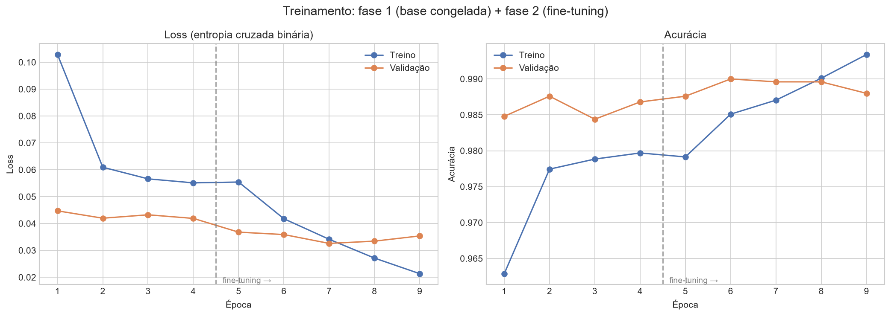
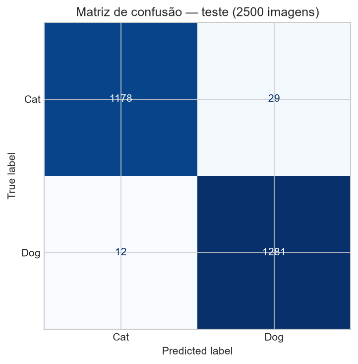
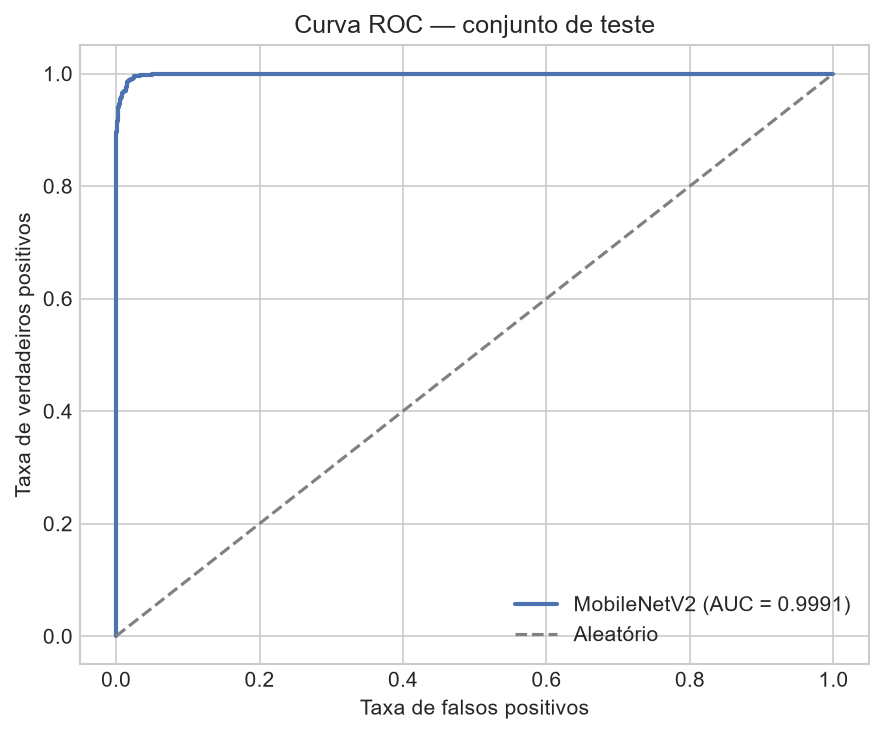
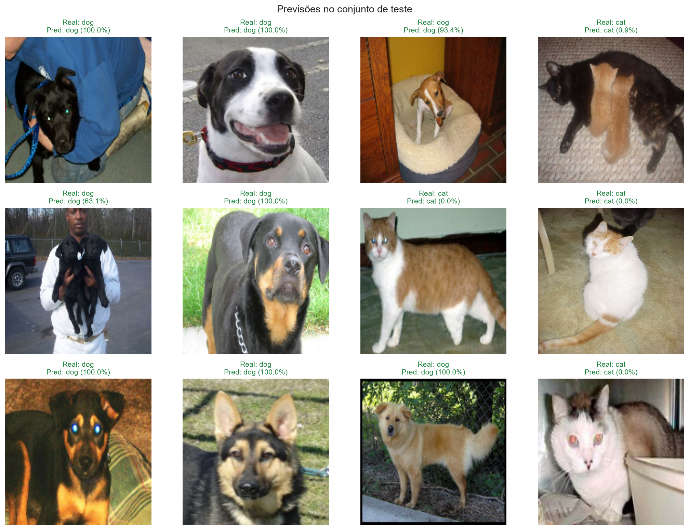
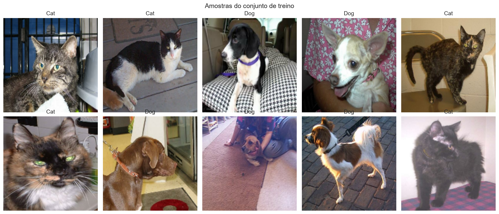
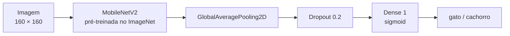
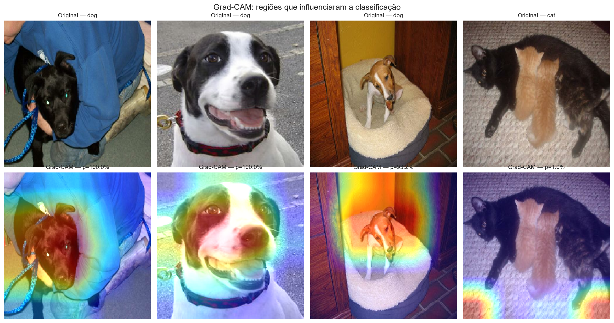

# 🐱🐶 Transfer Learning com MobileNetV2 — Gatos vs Cachorros


Projeto do desafio **"Treinamento de Redes Neurais com Transfer Learning"** da [DIO](https://www.dio.me/). O objetivo é aplicar **Transfer Learning** em uma rede de Deep Learning para classificar imagens de **gatos** e **cachorros**, documentando todo o processo de forma clara e reproduzível.

> **TL;DR:** reaproveitando os pesos da **MobileNetV2** (pré-treinada no ImageNet) e fazendo fine-tuning das últimas camadas, o modelo atinge **98,36% de acurácia** e **AUC-ROC de 0,9991** no conjunto de teste, treinando em poucos minutos com GPU e com uma fração dos dados que seriam necessários para treinar uma CNN do zero.

---

## 🎯 Sobre o desafio

O desafio propõe sair da teoria e colocar a mão na massa: usar uma rede pré-treinada como ponto de partida, adaptá-la a um novo problema e documentar a experiência no GitHub.

O que foi entregue:

- **Notebook completo e executado** (`notebooks/transfer_learning_cats_vs_dogs.ipynb`), pronto para rodar no Google Colab;
- **Pipeline de dados** com `tf.data`, redimensionamento, normalização e data augmentation;
- **Duas fases de treinamento**: extração de características (base congelada) e fine-tuning;
- **Avaliação** com acurácia, precisão, recall, F1-score, AUC-ROC e matriz de confusão;
- **Interpretabilidade** com Grad-CAM;
- **Script de inferência** (`src/predict.py`) para classificar novas fotos;
- **Exportação** do modelo em `.keras`, SavedModel e `.tflite`.

---

## 📊 Resultados

Métricas no conjunto de **teste** (2.500 imagens nunca vistas no treino):

| Métrica | Valor |
|---|---|
| **Acurácia** | **98,36%** |
| **Precisão** | 98,37% |
| **Recall** | 98,36% |
| **F1-score** | 98,36% |
| **AUC-ROC** | **0,9991** |
| Loss (entropia cruzada) | 0,0426 |

Precisão, recall e F1 são médias ponderadas por classe (2.500 imagens de teste).

### Curvas de treinamento



A linha tracejada marca o início do **fine-tuning**. A fase 1 já resolve a maior parte do problema (acurácia de validação em ~98,7% ao final), e a fase 2 chega a ~99,0% — um ganho real, porém modesto, comportamento comum no fine-tuning. O `EarlyStopping` restaurou o checkpoint com a melhor AUC de validação.

### Matriz de confusão



A matriz mostra o desempenho equilibrado entre as duas classes, sem viés evidente para gatos ou cachorros.

### Curva ROC



A AUC de **0,9991** indica que o modelo separa as duas classes com folga em praticamente qualquer limiar de decisão.

### Previsões em imagens do teste



Títulos em verde indicam acerto; em vermelho, erro — com a confiança associada a cada previsão.

---

## 🗂️ Dataset

| Item | Detalhe |
|---|---|
| Nome | Cats vs Dogs (Kaggle / Microsoft Research) |
| Imagens | 25.000 originais → **24.991 válidas** (9 arquivos inválidos descartados) |
| Classes | `cat` (0) e `dog` (1) — balanceadas |
| Split usado | 80% treino / 10% validação / 10% teste |
| Download | ~800 MB na primeira execução (cacheado depois) |
| Fonte | [kaggle.com/c/dogs-vs-cats](https://www.kaggle.com/c/dogs-vs-cats) · [arquivo oficial](https://download.microsoft.com/download/3/E/1/3E1C3F21-ECDB-4869-8368-6DEBA77B919F/kagglecatsanddogs_5340.zip) · [catálogo TFDS](https://www.tensorflow.org/datasets/catalog/cats_vs_dogs) |

O dataset original não traz um split oficial de teste, então a divisão é feita manualmente (80/10/10) com uma semente fixa. O conjunto de teste é usado **uma única vez**, na avaliação final.

O notebook baixa o zip oficial, extrai e **valida cada imagem decodificando-a**: arquivos com extensão `.jpg` que na verdade são BMP/GIF/PSD e imagens corrompidas são descartados automaticamente (9 arquivos). O fluxo não depende do TensorFlow Datasets, o que o torna compatível com Windows, Linux e Colab. O mesmo dataset também está catalogado no [TFDS](https://www.tensorflow.org/datasets/catalog/cats_vs_dogs), mas aqui usamos o zip oficial para controlar a validação e a divisão dos dados.

<p align="center">
  
</p>

### Quer usar suas próprias fotos?

O notebook já monta a lista de arquivos a partir das subpastas de `DATA_DIR`, então a adaptação é simples: basta apontar `DATA_DIR` para uma pasta no formato abaixo (o restante do pipeline continua igual).

```
data/
├── gatos/
│   ├── gato1.jpg
│   └── ...
└── cachorros/
    ├── cachorro1.jpg
    └── ...
```

O restante do pipeline (pré-processamento, duas fases de treino, avaliação) continua igual. É justamente aí que o Transfer Learning faz mais diferença: com poucas dezenas de fotos por classe já é possível obter bons resultados.

---

## 🧠 Metodologia



### Fase 1 — Extração de características

- A base **MobileNetV2** é carregada com pesos do ImageNet e **congelada**;
- A camada de classificação original (1.000 classes) é removida (`include_top=False`);
- Uma nova cabeça é treinada: `GlobalAveragePooling2D → Dropout(0.2) → Dense(1, sigmoid)`;
- Otimizador **Adam** com `learning_rate = 1e-3`;
- Apenas **1.281 parâmetros** são treinados nessa etapa.

Por que congelar? Porque as convoluções iniciais já aprenderam detectores genéricos (bordas, texturas, formas) que servem para praticamente qualquer imagem. Treinar só a cabeça é rápido e evita destruir esse conhecimento.

### Fase 2 — Fine-tuning

- As **últimas 30 camadas** da base são descongeladas;
- As camadas de **Batch Normalization permanecem congeladas**, para não desestabilizar o treino;
- Otimizador **Adam** com `learning_rate = 1e-5` (100× menor);
- O modelo parte dos melhores pesos da fase 1.

Taxa de aprendizado baixa é essencial aqui: atualizações grandes nos pesos pré-treinados jogariam fora o que a rede já sabe.

### Data augmentation

Aplicado **somente no treino**, diretamente no pipeline `tf.data`:

- Espelhamento horizontal;
- Variação de brilho (`±0,1`);
- Variação de contraste (0,9–1,1);
- Variação de saturação (0,9–1,1).

Isso aumenta a diversidade artificial do conjunto e reduz overfitting, sem custo de armazenamento.

### Callbacks

| Callback | Configuração | Papel |
|---|---|---|
| `ModelCheckpoint` | monitora `val_auc` | salva o melhor modelo de cada fase |
| `EarlyStopping` | paciência 2–3 | interrompe se não houver melhora |
| `ReduceLROnPlateau` | fator 0,5 / paciência 2 | reduz a LR quando a validação estagna |

### Por que MobileNetV2?

| Critério | MobileNetV2 |
|---|---|
| Parâmetros da base | ~2,2 milhões (leve) |
| Velocidade | alta, inclusive em CPU |
| Disponibilidade | pesos prontos no `tf.keras.applications` |
| Deploy | fácil conversão para `.tflite` |

Para o contexto do desafio (Colab gratuito, dataset pequeno), é uma escolha melhor do que VGG16/ResNet50: menos memória, treino mais rápido e desempenho excelente em classificação binária.

### Interpretabilidade com Grad-CAM



O Grad-CAM usa os gradientes da saída em relação à última camada convolucional (`Conv_1`) para mostrar **quais regiões da imagem mais influenciaram a decisão**. É uma ferramenta de conferência: se o calor estiver concentrado no animal (rosto, orelhas, corpo) e não no fundo, isso indica que a rede aprendeu características relevantes do domínio.

---

## 📁 Estrutura do repositório

```
.
├── README.md
├── LICENSE
├── requirements.txt
├── .gitignore
├── notebooks/
│   └── transfer_learning_cats_vs_dogs.ipynb   # notebook completo e executado
├── src/
│   └── predict.py                             # inferência em novas imagens
├── referencias/
│   └── transfer_learning.ipynb                # material de apoio (VGG16 + Caltech-101)
├── images/                                    # gráficos gerados pelo notebook
│   ├── amostras_dataset.png
│   ├── distribuicao_classes.png
│   ├── curvas_fase1.png
│   ├── curvas_treinamento.png
│   ├── matriz_confusao.png
│   ├── curva_roc.png
│   ├── previsoes_teste.png
│   └── gradcam.png
└── models/                                    # gerado ao executar (binários fora do Git)
    ├── fase1_cabeca.keras
    ├── fase2_finetuning.keras
    ├── cats_vs_dogs_mobilenetv2.keras
    ├── cats_vs_dogs_mobilenetv2.tflite
    ├── saved_model/
    ├── metricas_teste.json
    ├── relatorio_classificacao.txt
    ├── relatorio_classificacao.json
    └── resumo_execucao.json
```

> Os arquivos de modelo são grandes e estão no `.gitignore`. Eles são recriados ao executar o notebook.

---

## ▶️ Como executar

### Opção 1 — Google Colab (recomendado)

[](https://colab.research.google.com/github/Subaruberu/dio-transfer-learning-cats-vs-dogs/blob/main/notebooks/transfer_learning_cats_vs_dogs.ipynb)

1. Abra o notebook no Colab pelo badge acima;
2. Ative a GPU em **Ambiente de execução → Alterar tipo de ambiente de execução → T4 GPU**;
3. Execute todas as células (**Runtime → Run all**).

Tempo estimado com o dataset completo: **15 a 25 minutos**.

### Opção 2 — Localmente

```bash
# 1. Clone o repositório
git clone https://github.com/Subaruberu/dio-transfer-learning-cats-vs-dogs.git
cd dio-transfer-learning-cats-vs-dogs

# 2. Crie e ative um ambiente virtual
python -m venv .venv
# Windows:
.venv\Scripts\activate
# Linux/macOS:
source .venv/bin/activate

# 3. Instale as dependências
pip install -r requirements.txt

# 4. Abra o notebook
jupyter notebook notebooks/transfer_learning_cats_vs_dogs.ipynb
```

Requisitos: **Python 3.10–3.12** e ~6 GB livres em disco (dependências + zip + dataset extraído).

### Inferência em uma imagem

Depois de executar o notebook (que salva `models/cats_vs_dogs_mobilenetv2.keras`):

```bash
python src/predict.py --imagem minha_foto.jpg
```

O script redimensiona a imagem para `160 × 160` e aplica o `preprocess_input` da MobileNetV2 antes da predição.

Saída:

```
Imagem: minha_foto.jpg
Classe prevista: dog (confiança: 98.6%)
P(cachorro) = 0.9862 | P(gato) = 0.0138
```

Para integração com outros scripts:

```bash
python src/predict.py --imagem minha_foto.jpg --json
```

---

## 📤 Publicando no GitHub

Repositório publicado em [github.com/Subaruberu/dio-transfer-learning-cats-vs-dogs](https://github.com/Subaruberu/dio-transfer-learning-cats-vs-dogs).

Para replicar em outro repositório:

```bash
git init
git add .
git commit -m "feat: transfer learning cats vs dogs com MobileNetV2"
git branch -M main
git remote add origin https://github.com/SEU_USUARIO/SEU_REPO.git
git push -u origin main
```

---

## 🧪 O notebook, passo a passo

| Seção | O que acontece |
|---|---|
| 1. Ambiente | imports, sementes, checagem de GPU |
| 2. Dataset | download via `get_file` + zip, validação das imagens, splits, amostras e balanceamento |
| 3. Pipeline | resize, `preprocess_input`, augmentation, `tf.data` |
| 4. Fase 1 | MobileNetV2 congelada + cabeça nova, 10 épocas |
| 5. Fase 2 | fine-tuning das últimas 30 camadas, 5 épocas |
| 6. Avaliação | métricas, classification report, matriz de confusão, ROC |
| 7. Previsões | 12 imagens do teste com classe real, prevista e confiança |
| 8. Grad-CAM | mapas de calor sobre as imagens |
| 9. Exportação | `.keras`, SavedModel e `.tflite` |
| 10. Conclusão | aprendizados, limitações e próximos passos |

> Na execução registrada, o `EarlyStopping` encerrou a fase 1 na 4ª época; a fase 2 usou as 5 épocas completas.

---

## 💡 Aprendizados

1. **Transfer Learning reduz drasticamente o custo de treinamento.** Na fase 1, apenas 1.281 parâmetros foram treinados — e o modelo já saiu com desempenho alto.
2. **A ordem das fases importa.** Treinar a cabeça antes de descongelar a base evita que gradientes aleatórios destruam os pesos pré-treinados.
3. **Fine-tuning exige taxa de aprendizado baixa.** `1e-5` foi suficiente para refinar as características sem catástrofe.
4. **Batch Normalization pede cuidado.** Mantê-las congeladas durante o fine-tuning trouxe mais estabilidade.
5. **Data augmentation é barato e eficaz.** Espelhamento e variações de cor ajudaram a generalização sem aumentar o dataset.
6. **Avaliar vai além da acurácia.** Precisão, recall, F1, AUC e matriz de confusão revelam comportamentos que a acurácia sozinha esconde.
7. **Interpretabilidade gera confiança.** O Grad-CAM permite conferir se o modelo olha para o animal e não para o fundo — um teste rápido para detectar atalhos aprendidos.

### Dificuldades encontradas

- O dataset não tem split oficial — foi necessário criar a divisão manualmente e garantir que o teste ficasse isolado;
- Imagens com tamanhos e ruídos variados exigem redimensionamento e augmentação cuidadosa;
- Rodar em CPU é viável, mas o treino completo pede GPU (Colab resolve bem).

---

## 🚀 Próximos passos

- [ ] Rodar o notebook no Colab com o dataset completo e comparar tempo e métricas com a execução local;
- [ ] Testar EfficientNetB0 e ResNet50 para comparar custo × acurácia;
- [ ] Aplicar k-fold cross-validation para estimativas mais robustas;
- [ ] Usar o dataset do projeto anterior (ou fotos próprias) como novo domínio;
- [ ] Publicar o `.tflite` em um app mobile ou web (TensorFlow.js);
- [ ] Criar uma API com FastAPI para servir o modelo.

---

## 📚 Referências

- [DIO — Formação em Machine Learning](https://www.dio.me/)
- [TensorFlow — Transfer learning and fine-tuning](https://www.tensorflow.org/tutorials/images/transfer_learning)
- [TensorFlow Datasets — Cats vs Dogs](https://www.tensorflow.org/datasets/catalog/cats_vs_dogs)
- [TensorFlow — tf.data](https://www.tensorflow.org/guide/data)
- [Kaggle — Dogs vs. Cats](https://www.kaggle.com/c/dogs-vs-cats)
- [Keras Blog — Building powerful image classification models using very little data](https://blog.keras.io/building-powerful-image-classification-models-using-very-little-data.html)
- [Notebook de referência — Transfer learning / fine-tuning (VGG16 + Caltech-101)](referencias/transfer_learning.ipynb)
- [MobileNetV2: Inverted Residuals and Linear Bottlenecks (Sandler et al., 2018)](https://arxiv.org/abs/1801.04381)
- [Grad-CAM: Visual Explanations from Deep Networks (Selvaraju et al., 2017)](https://arxiv.org/abs/1610.02391)
- [Keras — Data augmentation](https://www.tensorflow.org/tutorials/images/data_augmentation)
- [GitHub — Documentação em Markdown](https://docs.github.com/pt/get-started/writing-on-github)

---

## ✅ Checklist de entrega (DIO)

- [x] Notebook com o projeto de Transfer Learning
- [x] README detalhado com metodologia e resultados
- [x] Gráficos e imagens organizados em `/images`
- [x] Script de inferência reutilizável
- [x] Código documentado e reprodutível
- [x] Execução completa com o dataset integral registrada no notebook
- [x] Publicar o repositório como público no GitHub — [Subaruberu/dio-transfer-learning-cats-vs-dogs](https://github.com/Subaruberu/dio-transfer-learning-cats-vs-dogs)
- [ ] Enviar o link no botão **"Entregar Projeto"** da DIO

---

## 👤 Autor

**Will** — projeto desenvolvido como parte do bootcamp da DIO.

Se este projeto te ajudou de alguma forma, deixe uma ⭐ no repositório!
